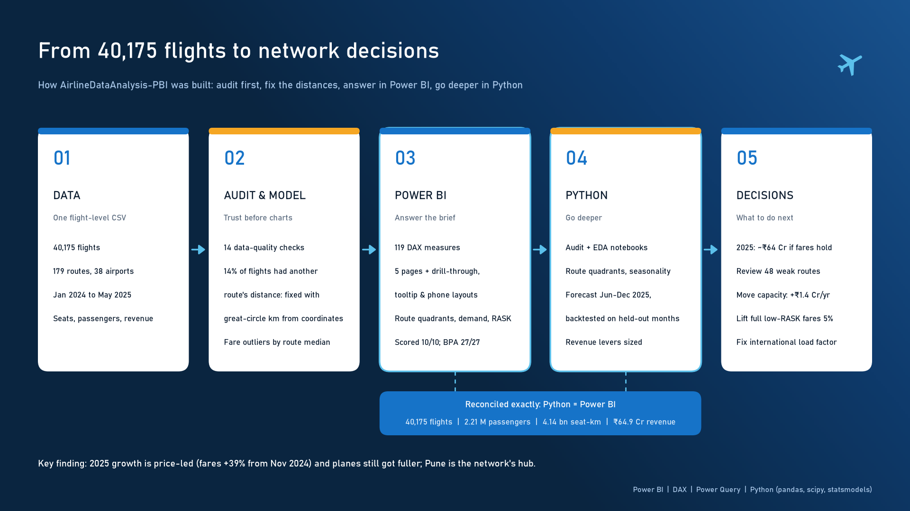
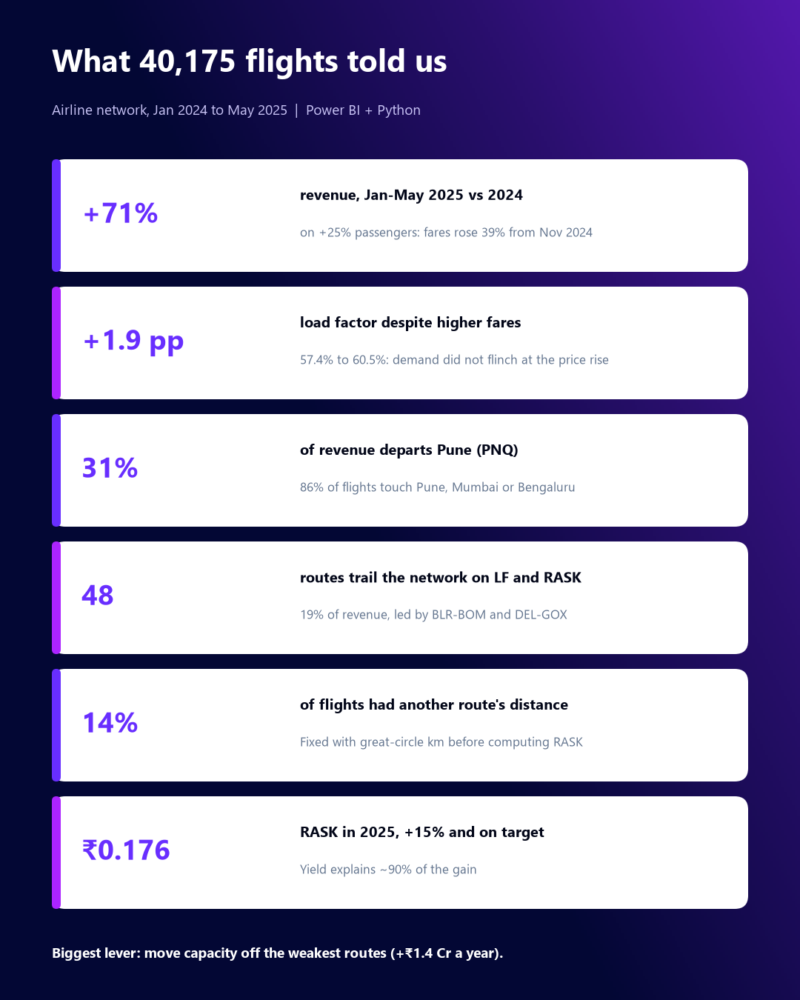
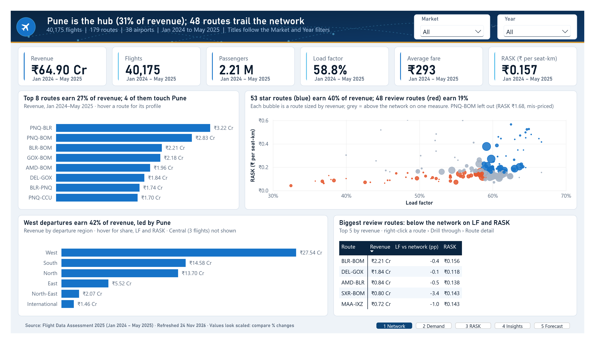
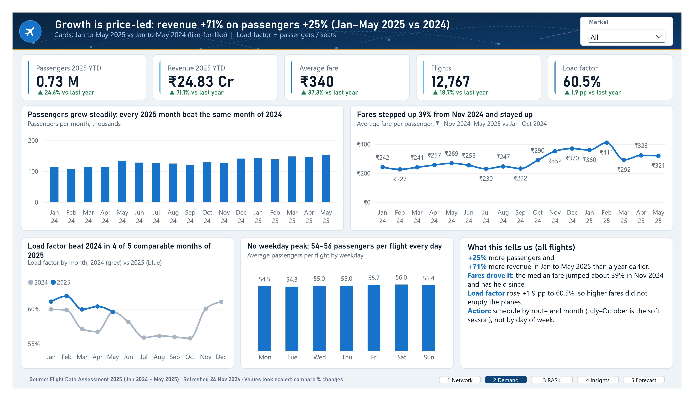
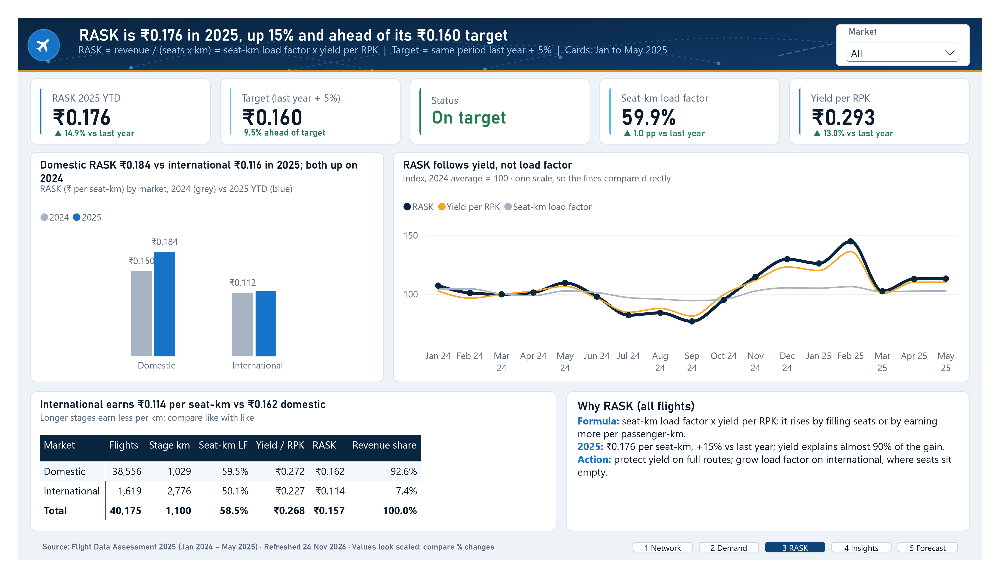
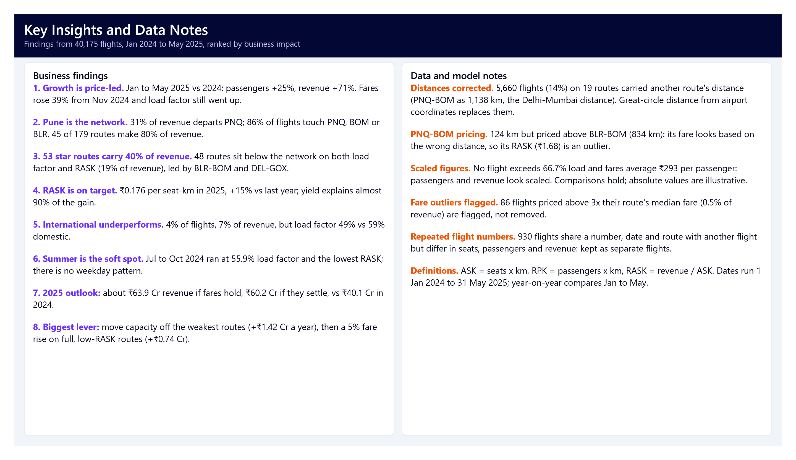
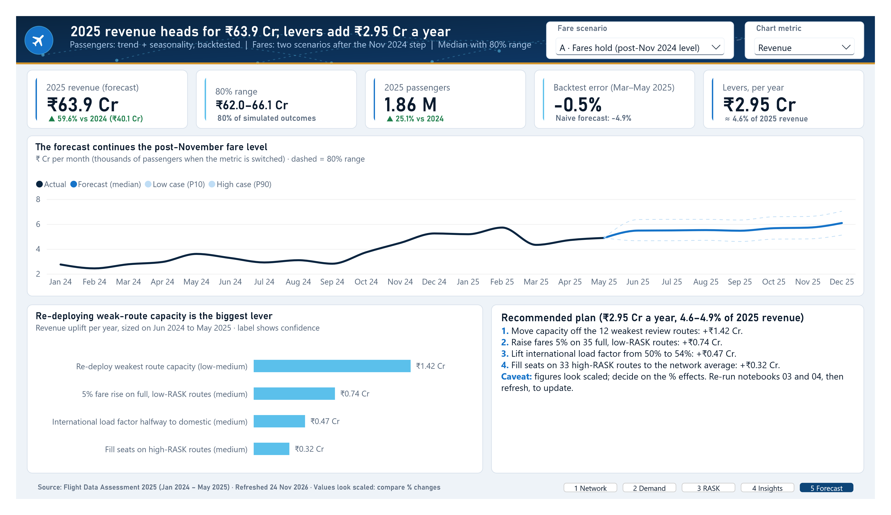

# AirlineDataAnalysis-PBI: Network, Demand and RASK for an Airline

An end-to-end analysis of 40,175 flights (179 routes, 38 airports, Jan 2024 to May 2025) in **Power BI** and **Python**:
route and network performance, demand trends, a revenue-per-seat-km KPI, a 2025 forecast and sized revenue levers.



---

## The brief, answered

| Question | Answer |
|---|---|
| **1. Network & route performance** | Pune is the hub: 31% of revenue departs PNQ and 86% of flights touch PNQ, BOM or BLR. 45 of 179 routes make 80% of revenue. 53 "star" routes (above the network on load factor and RASK) earn 40%; 48 routes trail on both (19%), led by BLR-BOM and DEL-GOX. |
| **2. Demand trends** | Jan–May 2025 vs 2024: flights +19%, passengers +25%, revenue +71%. Fares stepped up 39% from Nov 2024 and load factor still rose (57.4% → 60.5%). July–October is the weak season; weekday makes almost no difference. |
| **3. KPI** | **RASK** (revenue per available seat-km) = seat-km load factor × yield per RPK. 2025 YTD ₹0.176, +15% vs last year and above its target (last year + 5%). Yield explains ~90% of the gain. |

## Key findings



- **Price-led growth.** Revenue rose almost three times faster than passengers, and demand did not fall when fares rose.
- **International underperforms.** It's 4% of flights and 7% of revenue, but load factor is 49% vs 59% domestic and RASK is ₹0.114 vs ₹0.162. Its stages are much longer, so compare like with like.
- **2025 forecast:**
  - About ₹63.9 Cr revenue if fares hold (80% range ₹62.0–66.1 Cr), or ₹60.2 Cr if they settle at the Mar–May level, against ₹40.1 Cr in 2024.
  - About 1.86 M passengers (+25%).
  - The passenger model was within 0.5% on the held-out Mar–May 2025.

### Revenue levers (per year, sized on Jun 2024 – May 2025)

| Lever | Uplift |
|---|---|
| Move capacity off the weakest "review" routes (valued at network-average RASK) | +₹1.42 Cr (2.8%) |
| 5% fare rise on full but low-RASK routes | +₹0.74 Cr (1.5%) |
| International load factor halfway to domestic | +₹0.47 Cr (0.9%) |
| Fill seats on high-RASK, low-load routes to the network average | +₹0.32 Cr (0.6%) |

---

## Power BI report

Five pages in a custom **Runway** aviation theme ([`_build/airline_theme.py`](_build/airline_theme.py)):

- **Colours:** night-sky navy `#0A2540` headers, sky blue `#1673C8`, contrail cyan `#5BC0EB`, and runway amber `#F5A623` for highlights.
- **Fonts:** Bahnschrift (the DIN-style airport-signage face) for titles and numbers.
- **Header artwork:** a flight-path band with a plane emblem, built as SVG ([docs/theme/header_runway.svg](docs/theme/header_runway.svg)).

The same theme module styles the LinkedIn visuals.

| Page | What it shows |
|---|---|
| 1. Network | Top 8 routes, route map coloured by quadrant (star / review), revenue by departure region, biggest review routes |
| 2. Demand | 2025 vs 2024 cards with change lines, monthly passengers, monthly fare, load factor by month, weekday pattern |
| 3. RASK | RASK vs target and its drivers, RASK by market, RASK / yield / load factor indexed to 2024 = 100 |
| 4. Insights | Eight ranked findings and the data/model notes |
| 5. Forecast | 2025 forecast under two fare scenarios with an 80% band, backtest, sized levers and a recommended plan |
| Route detail | Drill-through page: right-click any route for its revenue, load factor vs network, fares and weekday pattern |
| Route tooltip | Report-page tooltip on the route visuals: position, revenue, load factor, RASK and a mini trend |

**Report design (v2, scored 10/10 on [a 10-point dashboard scorecard](docs/review/scorecard.md)):**
- Every page and chart title states its finding ("Growth is price-led: revenue +71% on passengers +25%").
- 14 title measures build these titles, so the numbers follow the Market, Year and Scenario slicers.
- Units are consistent: ₹ Cr for revenue, M for passengers.
- KPI cards show a ▲▼ change line in green or red.
- There are no dual-axis charts: the RASK drivers are indexed to one scale.
- Every page has a footer with the source, the refresh date and the main caveat, plus a page navigator.
- The Market slicer is synced across pages 1–3.
- Accessibility: alt text on every visual, AA-contrast status colours and phone layouts for every page.

| | | |
|---|---|---|
|  |  |  |
|  |  | |

**Model:**
- `Flights` fact table with role-playing `Origin Airport` and `Destination Airport` dimensions (from [reference/airports.csv](reference/airports.csv)) and a `Date` table.
- 119 DAX measures in `_Measures`, organised in 8 display folders.
- Every visible table, column and measure has a description.
- Best Practice Analyzer: 27 of 27 rules pass ([results](docs/review/bpa_results.json)).
- Folder 7 holds the display measures: card text, change lines and colours, and the footer.
- Forecast and lever tables are loaded from the notebooks' output.

**Data rules in Power Query** (mirrored in [`analysis/src/metrics.py`](analysis/src/metrics.py)):
- **Distance:** keep the recorded distance when it is within 0.9–1.25× the great-circle distance between the airports; otherwise use the great-circle distance. This fixes 5,660 flights (14%).
- **Seat-km:** ASK = seats × km and RPK = passengers × km; RASK = revenue / ASK.
- **Fare outliers:** a flight is flagged when its fare per passenger is above 3× its route's median. 86 flights are flagged, not removed.

## Python analysis

| Notebook | Purpose |
|---|---|
| `00_load_clean` | Applies the rules and **asserts every total matches Power BI** (flights, passengers, seats, revenue, ASK, RPK) |
| `01_audit` | 14 data-quality checks: 6 pass, 7 warn, 1 fail (distances) |
| `02_eda` | The brief's three questions: route quadrants, hubs, trends, seasonality, RASK decomposition |
| `03_forecast` | Passengers (trend + seasonality, backtested) × fare scenarios → Jun–Dec 2025 with bands |
| `04_levers` | Four revenue levers, plus the facts that feed the report's text |

The notebooks are generated by `analysis/_make_notebooks.py`. The model and pages are generated by `_build/make_semantic_model.py` and `_build/build_report.py`.

---

## Repository layout

```
AirlineDataAnalysis-PBI.pbip            Power BI project (open in Power BI Desktop)
AirlineDataAnalysis-PBI.SemanticModel/  Model as TMDL: tables, DAX, Power Query, relationships
AirlineDataAnalysis-PBI.Report/         Report as PBIR JSON
reference/airports.csv                  38 airports: city, state, country, region, coordinates
analysis/                               Notebooks, shared metrics module, outputs and figures
_build/                                 Generators for the model, pages and LinkedIn visuals
docs/                                   Approach diagram, insights card, dashboard images, LinkedIn post
```

## How to run

**Data.** The source file `Flight Data Assessment 2025.csv` is not committed. Put it in `Raw Data/`.

**Power BI.**
1. Open `AirlineDataAnalysis-PBI.pbip` in Power BI Desktop.
2. In **Transform data → Manage Parameters**, set `ProjectFolder` to your clone and `SourceFile` to the CSV.
3. Refresh.

**Python.**

```bash
pip install -r requirements.txt
cd analysis
jupyter nbconvert --to notebook --execute --inplace 00_load_clean.ipynb 01_audit.ipynb 02_eda.ipynb 03_forecast.ipynb 04_levers.ipynb
```

## Caveats

- **The data looks scaled or synthetic.** No flight is more than 66.7% full and fares average ₹293 per passenger. Comparisons and trends hold; the absolute rupee and passenger figures are illustrative.
- **PNQ–BOM** (124 km) is priced above BLR–BOM (834 km). Its fare looks based on the wrong distance, so its RASK (₹1.68) is an outlier and sits off the route-map scale.
- **The forecast has only 17 months of history.** Seasonality comes from a single year and is shrunk by half.

## Tools

Power BI Desktop (DAX, Power Query, TMDL/PBIR) · Python (pandas, NumPy, SciPy, statsmodels, matplotlib, seaborn) · Jupyter
